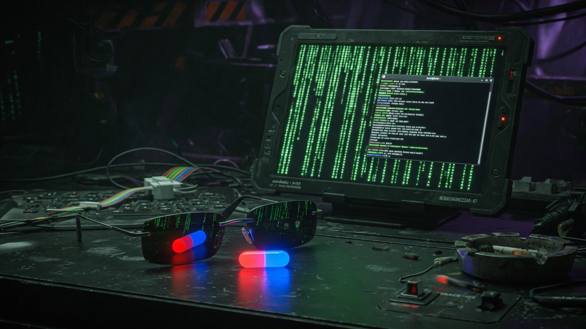

# `dotfiles` // The Nebuchadnezzar Construct (Morpheus Edition)

[](https://github.com/longdenjay00-sketch/dotfiles/actions/workflows/deploy.yml)
**[🕶️ Live Morpheus Construct Dashboard (GitHub Pages)](https://longdenjay00-sketch.github.io/dotfiles/)**



> *"You take the blue pill, the story ends. You take the red pill, you stay in Wonderland, and I show you how deep the rabbit hole goes."*

Portable, container-adaptive dotfiles and **Morpheus** AI harness configuration for two runtimes on one `aarch64` tablet—plus any fresh Linux container you clone into:

- **🔴 Red Pill (The Construct / Guest Container)** — Kali GNU/Linux Rolling (`aarch64`) inside a Termux `proot-distro` Debian container (or any fresh Debian, Ubuntu, Kali, Alpine, or Docker container). Keeps the signature two-line `root㉿kali` prompt (`┌──(root㉿kali)-[...]`) everywhere.
- **🔵 Blue Pill (Zion Gate / Termux Host)** — Android Termux host configuration (`termux.properties` with two-row `tmux` extra-keys and `termux/.bashrc` with `deb` / `kali` PRoot entry aliases).
- **🕶️ Morpheus AI Harness Integration** — Installs `AGENTS.md`, `GEMINI.md`, `GROK.md`, and `Morpheus.toml` so **Antigravity (`agy`)**, **Grok**, and **OpenCode** operate as **Morpheus**, respecting your Johnny Decimal areas and container nuances.

Nothing in this repository is a secret store: no keys, tokens, shell history, or `.env` files are ever tracked.

---

## Repository Layout

| Path | Target | Role |
| :--- | :--- | :--- |
| [`setup.sh`](setup.sh) | Host or Guest | Non-destructive bootstrap script (`--dry-run`, `--termux`, `--guest`, `--init-jd`). |
| [`.zshrc`](.zshrc) | `~/.zshrc` | Interactive Zsh with Kali two-line `root㉿kali` prompt, `^P` toggle, completion, syntax highlighting, autosuggestions, `pydocs-extract`, and `morpheus` telemetry command. |
| [`.bashrc`](.bashrc) | `~/.bashrc` | Interactive Bash with the same Kali two-line `root㉿kali` prompt, `pydocs-extract`, and `morpheus` telemetry command. |
| [`.profile`](.profile) | `~/.profile` | Login shells; sources `~/.bashrc`, `~/.local/bin/env`, and adds `~/.local/bin` & `~/.opencode/bin` to `PATH`. |
| [`.gitconfig`](.gitconfig) | `~/.gitconfig` | Portable GitHub credential helper via `!gh auth git-credential` (resolves `gh` dynamically via `PATH`). |
| [`termux.properties`](termux.properties) | `~/.termux/termux.properties` | Termux host UI: fullscreen, black background, and two-row `tmux` (`Ctrl-b`) extra keys. |
| [`termux/.bashrc`](termux/.bashrc) | `~/.bashrc` (Termux) | Termux host shell with `deb` / `kali` (`proot-distro login debian`) aliases and Matrix green prompt. |
| [`agents/AGENTS.md`](agents/AGENTS.md) | `~/AGENTS.md`, `~/.gemini/GEMINI.md`, `~/.grok/GROK.md` | Configures **Antigravity (`agy`)**, **Grok**, and **OpenCode** to act as **Morpheus** and file work in the Johnny Decimal system. |
| [`agents/Morpheus.toml`](agents/Morpheus.toml) | `~/.grok/personas/Morpheus.toml` | Grok CLI persona definition for Morpheus. |

---

## Quickstart & Portable Container Bootstrap

Clone the repository into any container or Termux environment and run `./setup.sh`:

```bash
git clone https://github.com/longdenjay00-sketch/dotfiles.git ~/dotfiles-repo
cd ~/dotfiles-repo

# 1. Preview what setup.sh detects without modifying a single byte:
./setup.sh --dry-run

# 2. Apply non-destructively (auto-detects Termux Host vs. Kali/Container Guest):
./setup.sh
```

### Explicit Runtime Modes

```bash
# Force container/guest install and initialize Johnny Decimal folders locally:
./setup.sh --guest --init-jd

# Force Termux host install (termux.properties + host .bashrc):
./setup.sh --termux
```

---

## Non-Destructive Safety Guarantees

`setup.sh` is engineered so it **cannot break a live machine**:

1. **Symlink Preservation:** On the primary tablet, `/root/.bashrc`, `/root/.zshrc`, `/root/.profile`, `/root/.gitconfig`, and `/root/00_INBOX`..`91_OBSIDIAN` are active symlinks into `55_INFRA/dotfiles` and `/data/data/com.termux/files/home`. `setup.sh` detects symlinks (`[ -L "$dest" ]`) and **skips them untouched**.
2. **Automatic Timestamped Backups:** In a fresh container where regular files (like a default `/root/.bashrc`) exist and differ, `setup.sh` backs them up to `~/.dotfiles_backup/<timestamp>/` before installing.
3. **Container Nuance Adaptation:**
   - Detects CPU architecture (`aarch64`, `x86_64`), OS distro (`/etc/os-release`), and package manager (`apt-get`, `apk`, `pacman`, `dnf`, `pkg`).
   - Keeps the signature `root㉿kali` prompt (`PROMPT_ALTERNATIVE=twoline`, `NEWLINE_BEFORE_PROMPT=yes`) even inside plain Debian or Ubuntu containers (customizable via `KALI_PROMPT_HOST`).
   - Checks both `/usr/share/...` and Termux `${PREFIX}/share/...` for `zsh-syntax-highlighting` and `zsh-autosuggestions`.

---

## The `morpheus` Telemetry Command

Once `.bashrc` or `.zshrc` is loaded, run `morpheus` at any prompt:

```text
┌──[ MORPHEUS // NEBUCHADNEZZAR CONSTRUCT ]
│ Host Arch : aarch64
│ Runtime   : Kali GNU/Linux Rolling
│ Harnesses : agy=ONLINE grok=ONLINE opencode=ONLINE
│ Guide     : /root/AGENTS.md (Morpheus Active)
└─> "Free your mind."
```

---

## Johnny Decimal System Spine

Managed and verified by `setup.sh` and enforced by `agents/AGENTS.md`:

| Area | Role |
| :--- | :--- |
| `00_INBOX` | Landing zone (sort promptly) |
| `10_DEV` | Code & repositories (`10_DEV/11_PROJECTS`) |
| `20_MEDIA` | Media assets & renders |
| `30_DOCS` | Technical notes & manuals |
| `40_BUSINESS` | Business operations |
| `50_OPS` | Host operations (`sshd`, `wake-lock`, `Termux:X11`) |
| `55_INFRA` | Live infrastructure & symlinked dotfiles (`55_INFRA/dotfiles`) |
| `60_TEMPLATES` | Reusable project templates |
| `70_BACKUP` | Dated backups |
| `80_ARCHIVE` | Cold storage (`debian.tar`) |
| `90_VAULT` | Secrets (`chmod 700` — never committed to Git) |
| `91_OBSIDIAN` | Knowledge base & notes |
